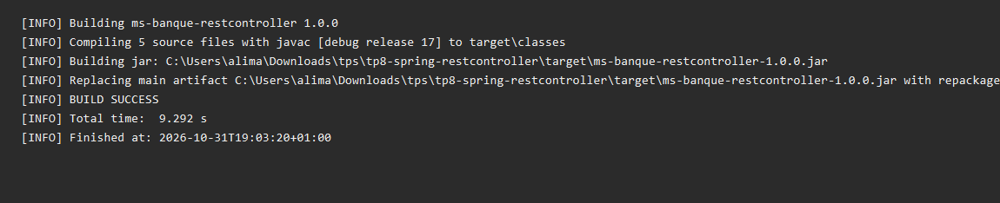
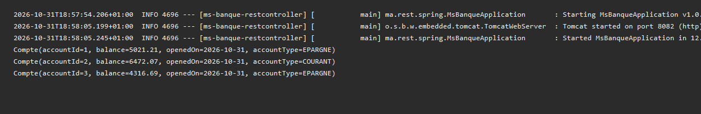
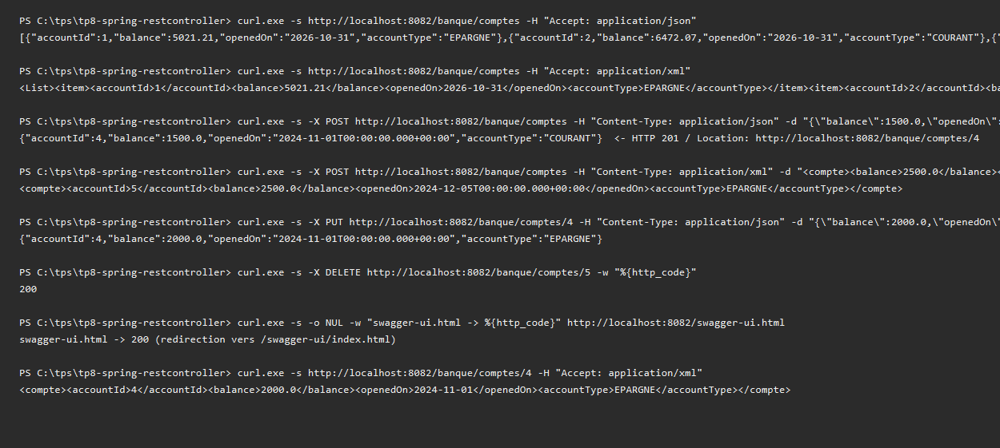
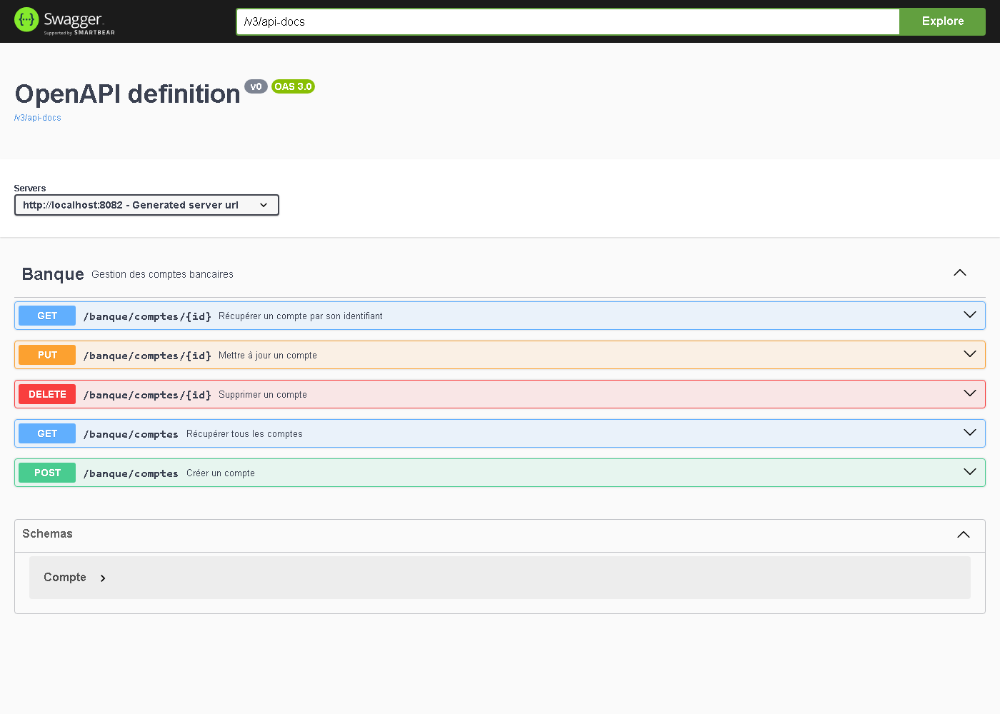

# TP 8 — Spring @RestController

## Compilation du projet Maven

## Démarrage de l'application et initialisation de la base H2

## Tests des endpoints REST (JSON et XML)

## Documentation Swagger UI

